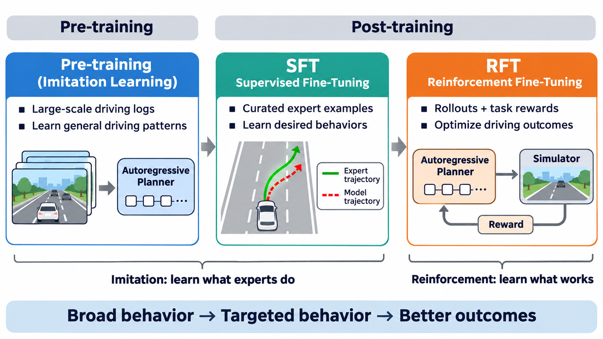
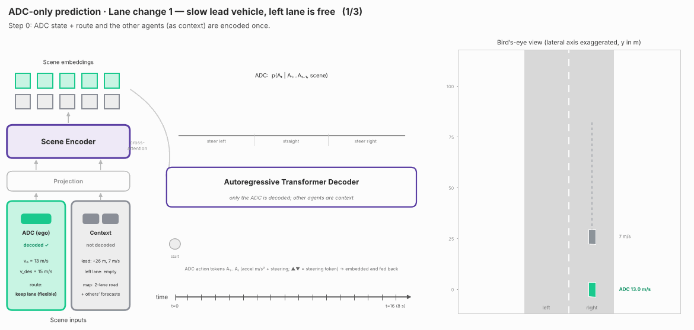

# Reinforcement Fine-Tuning for Planner Model

## Why Imitation Is Not Enough?

Planner models like Multipath, GameFormer, MTR are trained through imitation learning. They learn to predict a multimodal distribution of ADC trajectories, represented by the means and covariances of multiple trajectory modes.

- **Core idea:** learn to reproduce the driving behaviors demonstrated in the training data
- **Training data:** human driving data
- **Training objective:** minimize the negative log-likelihood (NLL) of the ground-truth trajectory under the predicted distribution

Imitation learning works well for common scenarios with sufficient high-quality demonstrations. However, it has limited ability to improve behaviors that are rare in the dataset. These include long-tail scenarios such as:

- Lane change near highway ramps
- Complex interactions with other road users
- Corner cases with only a few human demonstrations

The fundamental limitation is that imitation learning optimizes for **similarity to logged human behaviors**, rather than directly optimizing **the outcome of a maneuver**. Moreover, the logged trajectory only provides one demonstrated solution, even though multiple safe behaviors may exist.

Reinforcement learning addresses this limitation by introducing **scenario-specific rewards**. For example, a lane-change completion reward can encourage the model to finish a required lane change, while safety and comfort rewards constrain how it is executed. This motivates a planner model that can generate different action sequences, evaluate their outcomes, and increase the probability of successful behaviors.

## Auto-regressive Model

### What Is an Autoregressive Model?

Unlike planner models with Gaussian Mixture Model head that predicts the whole future trajectory at once, an autoregressive model generates a future trajectory **sequentially**.

At each time step, it predicts a probability distribution over possible ADC actions and selects the next action based on the current scene and its previously generated actions.

This is similar to how a language model generates text one token at a time. Each selected action becomes part of the input context for predicting the next one.

### Difference from GameFormer

The two models represent future behavior differently:

| Model | Output |
|---|---|
| GameFormer | Directly predicts the parameters of multiple future trajectory distributions, such as their means and covariances. |
| Autoregressive model | Predicts a conditional action distribution at every time step and constructs the trajectory sequentially. |

### Tokenization

Before applying autoregressive modeling, we should first answer: 

> *Where do the ADC actions come from?*

ADC actions are discrete tokens converted from continuous trajectories. Possible tokenization methods include:

1. Representing each action as an `(x, y, heading)` token at a fixed interval, such as every 0.5 seconds. ([SMART](https://arxiv.org/abs/2405.15677))
2. Representing each action as `(acceleration, curvature)` and discretizing the continuous ranges into bins. ([Alpamayo-R1](https://arxiv.org/abs/2511.00088))

The first approach directly models future vehicle **states**, while the second models how the vehicle **moves** from one state to the next.

### What Does an Autoregressive Model Predict?

At each future time step, the model predicts a probability distribution over the action vocabulary (logits):

```
logits shape: [batch_size, num_time_steps, num_actions]
```

For one trajectory, the output can be viewed as:

```
t0: [p(action₁), p(action₂), ..., p(actionₙ)]
t1: [p(action₁), p(action₂), ..., p(actionₙ)]
...
tT: [p(action₁), p(action₂), ..., p(actionₙ)]
```

An action token is sampled or selected at each step and used to update the ADC state before predicting the next token.

### Rollout

A **rollout** is one complete execution of this sequential generation process — from the initial to the final prediction step.

One rollout produces one possible future trajectory. Because driving is uncertain, we need to produce multiple rollouts that represent different possible behaviors. For example, the vehicle may change lanes immediately, change lanes later, or remain in the current lane.

The model selects actions step by step and reacts to its own earlier choices, the same way a language model writes one word at a time.

### Why Is an Autoregressive Model a Natural Fit for Reinforcement Fine-Tuning?

An autoregressive planner defines an **explicit policy over action sequences**.

During a rollout, it samples an action from a probability distribution at each step. The complete trajectory can then be evaluated using rewards, and the model can be updated to increase the probability of higher-reward action sequences (trajectories).

**Workflow:**

```
action sampling → trajectory rollout → outcome reward → policy update
```

With the model structure in place, the next question is how to train it: from large-scale pre-training to supervised and reinforcement-based post-training.

## From Pre-training to Post-training (SFT and RFT)

Training an autoregressive model usually consists of two stages: **pre-training** and **post-training**.



### Pre-training

Datasets for pre-training:
- Human driving data
- Autonomous driving data (after filtering)
- Open-source data: nuPlan, Waymo, Argoverse

During pre-training, the model learns general driving patterns from a large amount of logged data given the scene context — such as road geometry, traffic signals, surrounding agents, and routing information.

In this stage, the model learns by answering:

> *In a scene like this, what would a human driver do next?*

However, its main objective is **prediction**: generating outputs similar to those in the training data. It does not directly tell the model whether the resulting behavior is safe, comfortable, or effective in closed-loop driving.

### Post-training

Post-training adapts the pre-trained model toward the behaviors we ultimately care about. Two important approaches are **Supervised Fine-Tuning (SFT)** and **Reinforcement Fine-Tuning (RFT)**.

#### Supervised Fine-Tuning (SFT)

SFT trains the model on carefully curated expert samples, such as:

- Datasets from different regions (US, Dubai)
- Specific scenarios

The model generates a trajectory, compares it with the expert trajectory, and learns to reduce the difference.

SFT is effective for teaching specific behaviors and adapting the model to a target data distribution. It is usually stable and relatively easy to scale.

However, SFT has an important limitation: **matching the expert trajectory is not always the same as producing the best driving behavior.** For example:

- Multiple trajectories may all be feasible, but SFT only treats the recorded one as the target.
- Safety, comfort, and progress are difficult to express using trajectory imitation alone.
- Small planning errors can accumulate when the model runs in closed loop.

## Reinforcement Fine-Tuning (RFT)

> SFT teaches the model **what the expert did**. RFT teaches the model **which outcomes are better**.

RFT provides a different training signal. Instead of only asking whether the model matches an expert trajectory, it evaluates the **outcome** of the model's behavior.

The generated trajectory or driving rollout is assigned a reward based on objectives such as:

- Collision avoidance
- Route progress
- Traffic-rule compliance
- Comfort
- Appropriate interaction with other agents

The model is then updated to make high-reward behaviors more likely and low-reward behaviors less likely.

### The RFT Training Pipeline

A key challenge in reinforcement fine-tuning is to realistically simulate how surrounding agents react to the ego vehicle's actions.

#### Open-loop RFT

A straightforward approximation is **open-loop RFT**, where surrounding agents replay their ground-truth trajectories.

During rollout, the model samples one ADC action at each time step and updates the ADC state accordingly. The scene is then re-encoded using the updated ADC state and the logged states of surrounding agents.

The key assumption is that **surrounding agents evolve independently of the ego vehicle**. Therefore, open-loop RFT approximates a full closed-loop RL rollout without requiring an interactive simulation environment.

| Advantages | Limitations |
|---|---|
| Does not require a reactive simulator. | Surrounding agents do not react to the ego vehicle's actions. |
| Rollout generation is lightweight, fast, and easy to scale. | Interaction-dependent rewards may be inaccurate — e.g., another vehicle will not slow down or yield when the ego merges. |
| Training is fast; no data update is needed. | Cannot fully evaluate the long-term consequences of the model's decisions. |

Open-loop RFT is therefore useful for efficient training and initial policy improvement, but closed-loop simulation is still needed for behaviors that depend heavily on interactions with other agents.

#### Reward Design

**Hard safety terms** (must be satisfied to receive a non-zero reward):

- Collision check
- Driving area compliance

**Soft cost terms:**

- Comfort
- Time-to-collision
- Speed limit compliance
- Progress

#### Optimization Objective

During fine-tuning, the pre-trained PlanNet model serves as a fixed **reference policy** $\pi_{\text{ref}}$, while the ego policy $\pi_e$ is updated.

For each scenario, a group of $G$ future trajectories is sampled from the old ego policy $\pi_{e_{\text{old}}}$, and the loss is defined as:

$$
\mathcal{L}_{\text{finetune}} = -\frac{1}{GF} \sum_{g=1}^{G} \sum_{t=1}^{F} \left[ \frac{\pi_e(y_t^g \mid C, P, y_{<t}^g)}{\pi_{e_{\text{old}}}(y_t^g \mid C, P, y_{<t}^g)} \hat{A}_t^g - \beta \, D_{\text{KL}}\left[\pi_e \,\|\, \pi_{\text{ref}}\right] \right]
$$

where:

- $G$: number of sampled trajectories (rollouts) in a group
- $F$: number of future time steps (action tokens) per trajectory
- $y_t^g$: action token at step $t$ of the $g$-th trajectory; $y_{<t}^g$ are the previously generated tokens
- $C, P$: scene context and planning inputs the policy is conditioned on
- $\hat{A}_t^g$: advantage of the $g$-th trajectory relative to the other trajectories in its group
- $\beta$: weight of the KL penalty

The RL term is the **importance sampling ratio** times the **group-relative advantage**. The **KL divergence term** keeps the fine-tuned policy close to the reference policy, thereby retaining the human-like behaviors learned during pre-training.

**Mixing in pre-training data.** The RFT dataset is mixed with the pre-training dataset, and a cross-entropy (CE) loss on pre-training samples is added.

The idea follows [InstructGPT](https://arxiv.org/abs/2203.02155) (PPO-ptx), which adds a pre-training log-likelihood term $\gamma\,\mathbb{E}_{x\sim D_{\text{pretrain}}}[\log \pi^{\text{RL}}_\phi(x)]$ to the maximized RL objective. Since we minimize a loss, this is equivalent to adding a cross-entropy loss on pre-training samples, weighted by $\gamma$.

$$
\mathcal{L}_{\text{total}}(\phi) = \mathcal{L}_{\text{finetune}} - \gamma \, \mathbb{E}_{x \sim D_{\text{pretrain}}}\left[\log \pi_e(x)\right]
$$

## Examples - Open-loop RFT

### Lane Change: ADC-only Prediction

**Action space:** `(acceleration, curvature)`, 5 × 3 = **15 actions** in total.

| Component | Values |
|---|---|
| Acceleration | $\{-3,\ -1.5,\ 0,\ +1,\ +2\}$ m/s² |
| Curvature | $\{\text{left},\ \text{straight},\ \text{right}\}$, where left / right use a fixed curvature $\kappa = 0.01$ |

**Action sequence:**

$$
[(a_0, \kappa_0),\ (a_1, \kappa_1),\ \dots,\ (a_n, \kappa_n)]
$$

Each token is applied for $\Delta t = 0.5$ s using a simple kinematic (unicycle) model.



#### Lane Change Case 1: Slow Lead Vehicle, Left Lane Free

**Scenario:**

- **ADC:** starts in the right lane at 13 m/s and wants to change to the left lane to overtake the slow lead vehicle.
- **Lead vehicle:** 26 m ahead in the same lane at 7 m/s.
- **Left lane:** empty.

**Pipeline:**

1. **Run the Scene Encoder**
   - **Input:** object histories, map, routing, traffic lights, etc.
   - **Output:** scene embeddings

2. **Run the Decoder $G$ times** ($G$ is the group size of generated trajectories)
   - **Input:**
     - Scene embeddings (the lead vehicle is context only, in the scene embeddings)
     - The embeddings of all ADC tokens sampled so far
   - **Each rollout step $t$:**
     - **Input:** the scene embeddings and the earlier ADC tokens $A_1 \dots A_{t-1}$
     - **Output:** a probability distribution over the 15 tokens, $p(A_t \mid A_1 \dots A_{t-1}, \text{scene})$
     - **Next:** $A_t$ is sampled and turned into the next ADC state $(x, y, \text{heading}, \text{speed})$. $A_t$ is then embedded and added to the decoder input for step $t+1$.

     > **Closed-loop decoding:** each token depends on the ADC's own earlier tokens. This is what lets it finish the lane change smoothly — steering left to move over, then right to straighten out.
   - **Output:** logits — a probability distribution over action tokens along the future time steps

3. **Compute rewards**

4. **Run the old policy**

5. **Calculate the GRPO loss**
